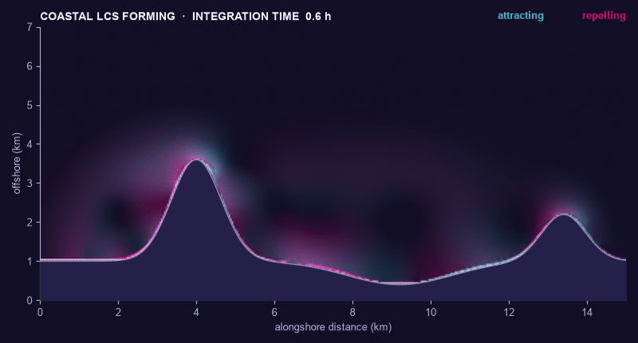
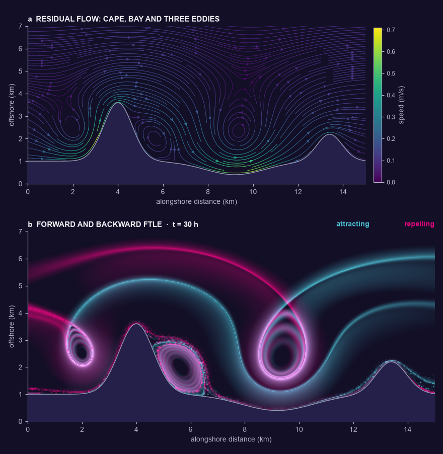

# LCS2D

**Fast Lagrangian coherent structures (FTLE / FSLE) from steady 2D velocity
fields — in Python.**



*Transport barriers of a coastal residual circulation drawing themselves as
the integration time grows: an alongshore current passes a cape and a bay,
with a pair of headland eddies and a bay gyre. Forward FTLE (repelling LCS)
in magenta, backward FTLE (attracting LCS) in light blue, 48 frames of both
in under a minute on a laptop CPU. Regenerate it with
`python examples/make_coastal_animation.py`; see
[the coastal example](#showcase-a-coastal-cape-and-bay) below.*

LCS2D takes a two-dimensional steady velocity field — from a hydraulic or CFD
model, PIV measurements, or an analytic test case — and computes the standard
diagnostics used to find **Lagrangian coherent structures (LCS)**: the hidden
skeleton of transport barriers and mixing regions in a flow.

* **FTLE** — finite-time Lyapunov exponent fields, forward in time
  (repelling structures) and backward (attracting structures)
* **FSLE** — finite-size Lyapunov exponent fields, with separation times
* **Particle advection** — bulk trajectory computation and export

Everything runs from the command line, writes plain `.npz` / `.csv` / `.png`
outputs, and is also usable as a Python library.

> **Looking for the old MATLAB code?** It lives on, deprecated but unchanged,
> in [`matlab/`](matlab/README.md). The Python engine reproduces its method
> (and fixes two numerical issues) at **~600× to ~20,000×** the speed — see
> [the migration guide](docs/migration_from_matlab.md).

## Installation

Python 3.10+ is required.

```bash
git clone https://github.com/jtuhtan/LCS2D.git
cd LCS2D
pip install -e .            # core (NumPy engine)
pip install -e .[fast]      # optional: adds Numba for the compiled engine
```

Then verify the installation against flows with known analytic answers:

```bash
lcs2d selftest
```

## Sixty-second tour

```bash
# 1. make the classic double-gyre test field (a .npz file)
lcs2d gyre -o gyre.npz        # or: lcs2d coast -o coast.npz (km, km/h)

# 2. compute a forward FTLE field (repelling LCS) ...
lcs2d ftle gyre.npz --t 10 -o out/ftle_fwd

# 3. ... and a backward one (attracting LCS)
lcs2d ftle gyre.npz --t 10 --backward -o out/ftle_bwd

# 4. compute an FSLE field
lcs2d fsle gyre.npz --t-max 40 -o out/fsle

# 5. advect a particle grid and keep the trajectories
lcs2d advect gyre.npz --t 10 --res 0.05 --save-every 10 -o out/traj
```

Each command prints a summary and writes `<out>.npz` (arrays), `<out>.csv`
(plain table for other tools), and `<out>.png` (a ready-made figure).
Run `lcs2d <command> --help` for all options.

**Your own data** goes in the same way — as a `.npz`, a four-column
`x y u v` text file (gridded *or* scattered), or a `.mat` file:

```bash
lcs2d info  myflow.csv           # sanity-check the field + suggested dt
lcs2d ftle  myflow.csv --t 30 -o out/myflow_ftle
```

See [Using your own data](docs/your_own_data.md) for formats and for how to
choose `--t`, `--res`, and friends.

## Showcase: a coastal cape and bay



`lcs2d.coastal_bay()` (or `lcs2d coast` on the command line) builds an
idealized coastal residual circulation in kilometres and km/h: a weak
eastward current (0.1 m/s) along a shore with a cape and a bay, plus the
counter-rotating eddy pair that tides leave on either side of a headland
(Zimmerman, 1981; Pingree and Maddock, 1977, off Portland Bill) and a gyre
over the bay. The eddies are vorticity patches and the streamfunction is
solved with the coast held at zero, so the shoreline is an exact streamline
and land is a no-flow mask, as in a hydraulic model.

The FTLE fields trace what the streamlines only hint at. The magenta
(repelling) and light-blue (attracting) ridges meet at saddle points
offshore and fence each eddy off from the coastal current: water caught in
the bay gyre or in the cape's lee eddy stays there, while water outside is
carried past. The rings inside each eddy are its shear. Particles that
graze the shore slow down in the land mask, which leaves the speckle along
the coast; read near-shore ridges with that in mind.

The double gyre stays the reference test case: `lcs2d gyre`,
`examples/run_double_gyre.sh` and `examples/make_ftle_animation.py` (its
[FTLE formation GIF](docs/img/ftle_formation.gif)) are unchanged, and the
selftest and benchmarks still use it.

## Library use

```python
import lcs2d

field  = lcs2d.double_gyre()                 # or lcs2d.coastal_bay(),
                                             # or lcs2d.load_field("my.csv")
result = lcs2d.ftle_field(field, t=10.0)     # LCSResult: .x, .y, .values
```

## Performance

The legacy MATLAB scripts re-evaluated a scattered-data
(`TriScatteredInterp`) interpolant for every particle at every time step —
`advect.m`'s own comments call it "a major bottleneck". The Python engine
resamples the field onto a regular grid once, then advects **all particles
simultaneously** with vectorized bilinear sampling and RK4, optionally
compiled and parallelized by Numba.

Benchmark (`python benchmarks/benchmark.py`): FTLE of the double gyre,
401×201 grid, 5,151 seeds → 25,755 particles × 1,257 time steps, all three
measured in the same session on a Windows 11 laptop (Intel Core Ultra 5,
Python 3.11):

| implementation                                        |      time | speedup |
|-------------------------------------------------------|----------:|--------:|
| legacy-style scattered interp + Euler (extrapolated)¹  |    ~1.5 h |      1× |
| **lcs2d** NumPy backend (bilinear + RK4, vectorized)  |     9.4 s |   ~590× |
| **lcs2d** Numba backend (compiled, parallel)          |    0.30 s | ~18,500× |

¹ The legacy algorithm reproduced in Python (SciPy's Delaunay-based
`LinearNDInterpolator`, the equivalent of `TriScatteredInterp`), measured on
a subsample and extrapolated. And note the new engine does 4 velocity
samples per step (RK4) where the legacy code did 1 (Euler).

The table pins the time step for a like-for-like comparison; the *default*
FTLE pipeline additionally exploits RK4's accuracy to take one-grid-cell
steps (verified to ~10⁻⁴ against a 4×-finer step), which lands the full
double-gyre FTLE at **~0.14 s (Numba)** or **~5 s (NumPy)** end to end.
The kernels compile with fused multiply-add (`fastmath`); the NumPy and
Numba backends agree to ~10⁻¹³ in particle positions, enforced by the
tests.

## Documentation

| Document | What's inside |
|---|---|
| [Quickstart](docs/quickstart.md) | Install, first FTLE field, reading the outputs |
| [Using your own data](docs/your_own_data.md) | Input formats, parameter choice, troubleshooting |
| [Theory & numerics](docs/theory.md) | FTLE/FSLE definitions, the auxiliary-grid method, integrator, references |
| [Migrating from MATLAB](docs/migration_from_matlab.md) | Script-by-script mapping, numerical differences |

For background on the original method and its application to environmental
flows, see: [Investigating Lagrangian Coherent Structures in Environmental
Flows](https://www.academia.edu/5643321/Investigating_Lagrangian_Coherent_Structures_in_Environmental_Flows)
and the [double-gyre video](https://www.youtube.com/watch?v=fs92NqIVIEM) made
with the original code.

## Testing

```bash
pip install -e .[dev]
pytest
```

The suite checks the engine against flows with exact analytic answers
(uniform strain, rigid rotation), verifies the double-gyre ridge, and
enforces agreement between the NumPy and Numba backends to near machine
precision.

## License and contact

GPL-3.0-or-later, © Jeffrey A. Tuhtan (jtuhtan@gmail.com).
The original MATLAB implementation dates to 2013; the Python engine is
version 2.0.
