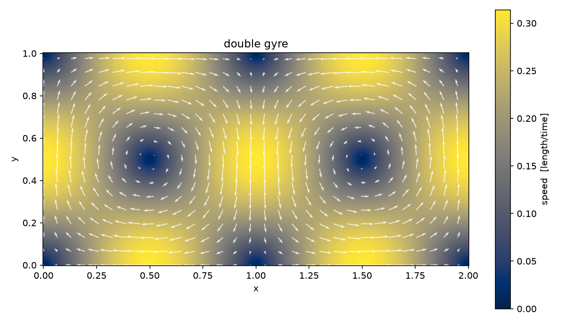
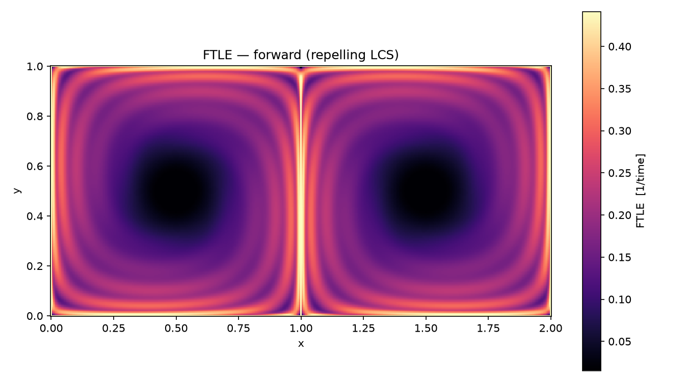
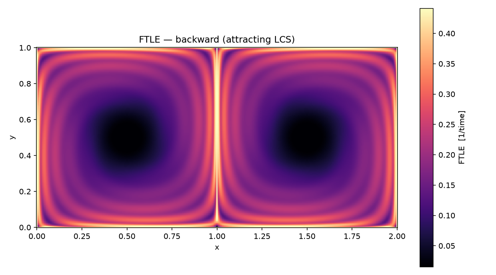
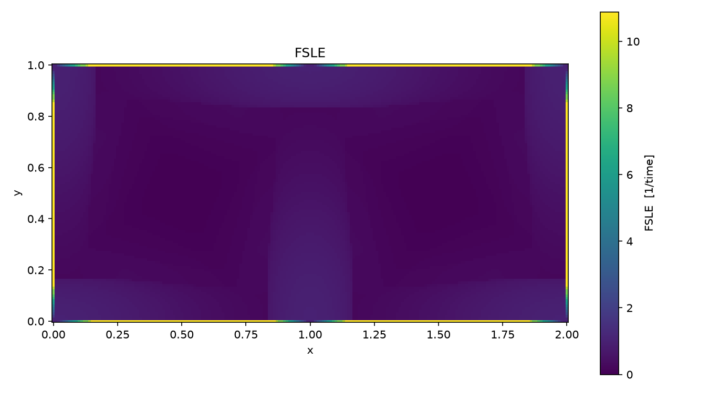

# Quickstart

This walks you from a fresh clone to your first FTLE field in about five
minutes, and explains what you are looking at along the way.

## 1. Install

```bash
git clone https://github.com/jtuhtan/LCS2D.git
cd LCS2D
pip install -e .
```

Optional but recommended — the Numba-compiled engine is ~30× faster than
the (already fast) NumPy one:

```bash
pip install -e .[fast]
```

> **Tip:** use a virtual environment (`python -m venv .venv` and activate
> it) to keep the install isolated. Everything works the same on Linux,
> macOS, and Windows.

## 2. Verify

```bash
lcs2d selftest
```

This computes FTLE and FSLE fields for flows whose answers are known
analytically (a uniform-strain saddle and the double gyre) and compares the
NumPy and Numba backends against each other. It prints a line per check
and exits nonzero if anything fails. If `lcs2d` is not on your PATH, use
`python -m lcs2d` instead — every command works both ways.

## 3. A first FTLE field

The double gyre is the standard LCS test case: two counter-rotating
vortices in a 2×1 box, separated by the line x = 1.

```bash
lcs2d gyre -o gyre.npz --plot     # writes gyre.npz + gyre.png
lcs2d ftle gyre.npz --t 10 -o ftle_out
```



You get three files:

| File | Contents |
|---|---|
| `ftle_out.npz` | arrays `x`, `y`, `values` (the FTLE field) + all parameters |
| `ftle_out.csv` | the same field as `x,y,ftle` rows — loads into anything |
| `ftle_out.png` | a ready-made figure |

**How to read the figure:** bright ridges are *repelling* material lines —
initially close particles that straddle a ridge end up far apart after
time `t`. For the double gyre the main ridge sits on the separatrix
x = 1, and the dark cores are the gyre centers where fluid just circulates
without stretching. Run the same command with `--backward` to get the
*attracting* structures (where particles end up), which for this steady
field is the mirror-image transport skeleton.




## 4. FSLE and trajectories

```bash
# FSLE: "how long until nearby particles separate by a factor alpha?"
lcs2d fsle gyre.npz --t-max 40 --alpha 2 -o fsle_out

# raw particle paths, for your own animations or analyses
lcs2d advect gyre.npz --t 10 --res 0.05 --save-every 10 -o traj
```



The FSLE output also stores the separation time per seed
(`extra_tau` inside the `.npz`). The trajectory file holds `t` with shape
`(n_saved,)` and `x`, `y` with shape `(n_saved, n_particles)`.

## 5. The same thing from Python

```python
import lcs2d

field = lcs2d.double_gyre()
result = lcs2d.ftle_field(field, t=10.0)

import matplotlib.pyplot as plt
plt.pcolormesh(result.x, result.y, result.values, cmap="magma")
plt.gca().set_aspect("equal"); plt.colorbar(label="FTLE [1/time]")
plt.show()
```

Every CLI option has a keyword-argument twin — see the docstrings of
`lcs2d.ftle_field`, `lcs2d.fsle_field`, and `lcs2d.advect`.

## 6. Next steps

* Feed in your own velocity data: [Using your own data](your_own_data.md).
* Understand the parameters you just used: [Theory & numerics](theory.md).
* Coming from the MATLAB scripts:
  [Migrating from MATLAB](migration_from_matlab.md).
